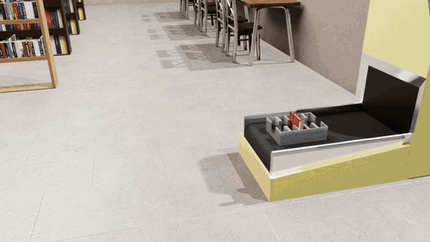
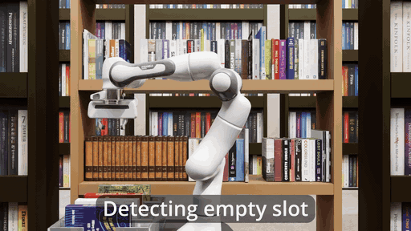
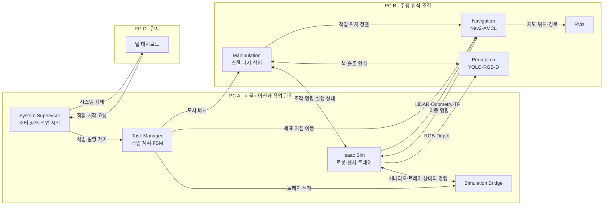

# 도서 자동 배치 시스템

<p align="center">
  
  
  
  
</p>

<!-- 아래 GIF 파일을 저장소에 업로드한 후 실제 경로에 맞게 수정합니다. -->
<p align="center">
  
  
</p>

<p align="center">
  <sub>전체 도서 배치 사이클 · 빈 공간 인식 및 도서 삽입</sub>
</p>

무인반납기에서 반환된 책을 **AMR과 로봇팔이 서가까지 운반하고, RGB-D 비전으로 빈 공간을 찾아 배치하는 ROS 2 기반 자동화 시스템**입니다.

Isaac Sim의 도서관 환경에서 트레이 인수, 자율주행, 서가 스캔, 책 인식, 파지·삽입과 HOME 복귀를 연결합니다. 웹 대시보드에서는 시스템 준비 상태와 로봇 위치를 확인하고 작업을 시작할 수 있습니다.

## 주요 기능

### 도서 분류 및 작업 관리

- 반납 도서의 분류코드를 기준으로 목표 서가와 이동 경로를 결정합니다.
- FSM으로 트레이 인수, 서가 이동, 도서 배치와 복귀 순서를 관리합니다.
- 각 작업의 진행 상태와 오류를 취합하고 시뮬레이션 재시작에 대응합니다.

### 자율주행 및 정밀 정렬

- Nav2와 AMCL을 이용해 도서관 지도에서 로봇의 위치를 추정하고 목표 지점까지 이동합니다.
- State Lattice 경로 계획과 MPPI 제어를 사용합니다.
- 서가 접근 후 위치와 방향을 정밀하게 정렬하고, 선택한 삽입 위치에 맞춰 차체를 조정합니다.

### RGB-D 기반 책·빈 공간 인식

- 손목 RGB-D 카메라와 YOLO 모델로 트레이의 책과 서가 영역을 검출합니다.
- 깊이 정보와 서가 평면 정보를 이용해 삽입 가능한 슬롯을 계산합니다.
- 인식 결과를 로봇팔 기준 좌표계로 변환하여 파지와 삽입에 전달합니다.

### 로봇팔 파지 및 삽입

- 로봇팔을 움직여 서가를 스캔하고 배치할 슬롯을 선택합니다.
- 트레이의 책을 재인식한 뒤 접근, 파지, 운반, 삽입, 해제와 후퇴를 수행합니다.
- 배치 결과를 확인한 뒤 AMR이 서가에서 후퇴하고 HOME으로 복귀합니다.

### 웹 관제 및 준비 상태 확인

- 지도, 로봇 위치, 작업 단계와 구성요소별 준비 상태를 표시합니다.
- 시뮬레이터, 주행, 비전과 조작 기능의 준비 여부를 확인합니다.
- 시스템이 `READY`일 때 운영자의 작업 시작 요청을 수락합니다.

## 시스템 구성

### 로봇과 시뮬레이션 환경

| 구성요소 | 역할 |
| --- | --- |
| Ridgeback 이동 베이스 | 트레이 운반, 서가 이동과 작업 위치 정렬 |
| Franka 로봇팔·그리퍼 | 서가 스캔, 책 파지와 삽입 |
| 손목 RGB-D 카메라 | 트레이 책과 서가 빈 공간 인식 |
| LiDAR | 주행용 거리 정보 제공 |
| 도서관 USD 환경 | 반납기, 트레이, 책과 서가를 포함한 작업 공간 |
| 웹 대시보드 | 상태 확인과 작업 시작 |

### 실행 구성

PC A가 시뮬레이션과 전체 작업을 관리하고, PC B가 주행·인식·조작을 처리합니다. PC C는 웹 관제 화면을 제공합니다.



### 작업 흐름

```text
시스템 준비
    ↓
작업 시작
    ↓
반납기 이동 및 트레이 인수
    ↓
분류코드에 따른 목표 서가 이동
    ↓
서가 스캔 및 빈 슬롯 선택
    ↓
차체 정렬 및 트레이 책 인식
    ↓
책 파지 · 운반 · 삽입
    ↓
배치 확인 및 서가 후퇴
    ↓
HOME 복귀
```

<details>
<summary><strong>작업 FSM 상태 보기</strong></summary>

```text
INITIALIZING
    → IDLE
    → PLANNING
    → NAV_TO_RETURN
    → RECEIVE_TRAY
    → SELECT_BOOK
    → NAV_TO_SHELF
    → PLACE_BOOK
    → UPDATE_DATA
    → NEXT_BOOK
    → RETURN_HOME
    → COMPLETED
    → IDLE
```

`PLACE_BOOK` 안에서 서가 스캔, 슬롯 선택, 차체 정렬, 책 인식, 파지와 삽입이 진행됩니다.

상세 상태 전이와 좌표계는 [시스템 아키텍처 문서](docs/02_architecture_and_flow.md)를 참고하세요.

</details>

## 기술 스택

| 영역 | 구성 |
| --- | --- |
| OS | Ubuntu 24.04 |
| 미들웨어 | ROS 2 Jazzy, Fast DDS |
| 시뮬레이션 | NVIDIA Isaac Sim 5.1, USD |
| 로봇 모델 | Ridgeback–Franka |
| 주행 | Nav2, AMCL, State Lattice Planner, MPPI Controller |
| 인식 | Ultralytics YOLO, PyTorch, OpenCV, RGB-D |
| 좌표 변환 | ROS 2 TF2 |
| 로봇팔 제어 | Franka FK/IK, 관절·직선 경로 계획, Isaac Sim 조작 실행기 |
| 작업 관리 | Python FSM, YAML 기반 작업 계획 |
| 웹 관제 | FastAPI, Uvicorn, WebSocket, HTML/CSS/JavaScript |
| 시각화 | RViz |
| 빌드·에셋 관리 | colcon, rosdep, Git LFS |

## 실행 환경 및 의존성

| 항목 | 준비 사항 |
| --- | --- |
| 호스트 환경 | Ubuntu 24.04, ROS 2 Jazzy, Python 3.12 |
| 시뮬레이션 PC | Isaac Sim 5.1, NVIDIA RTX GPU와 드라이버 |
| 그래픽 환경 | Isaac Sim GUI를 표시할 데스크톱 세션 |
| ROS 도구 | colcon, rosdep, Nav2, TF2, cv_bridge |
| 비전 환경 | 프로젝트 루트의 `.venv` |
| 웹 환경 | FastAPI, Uvicorn, PyYAML |
| 에셋 다운로드 | Git LFS |
| 분산 실행 | PC 간 유선 통신, 동일한 ROS_DOMAIN_ID, Fast DDS 프로파일 |

Isaac Sim은 설치에 포함된 Python 환경으로 실행합니다. ROS 노드는 호스트 Python 3.12를 사용하며, 비전 패키지는 프로젝트의 `.venv`에서 불러옵니다.

## 설치 및 준비

### 1. 저장소 받기

```bash
sudo apt update
sudo apt install -y git git-lfs

git lfs install

cd ~
git clone https://github.com/lhm3185/book-shelving-system.git
cd book-shelving-system

git lfs pull
```

### 2. ROS 및 웹 의존성 설치

ROS 2 Jazzy 설치를 완료한 환경에서 실행합니다.

```bash
sudo apt install -y \
  python3-colcon-common-extensions \
  python3-rosdep \
  python3-venv \
  python3-pip \
  python3-fastapi \
  python3-uvicorn \
  python3-yaml \
  ros-jazzy-navigation2 \
  ros-jazzy-nav2-bringup \
  ros-jazzy-pointcloud-to-laserscan \
  ros-jazzy-rmw-fastrtps-cpp \
  ros-jazzy-tf2-ros \
  ros-jazzy-tf2-geometry-msgs \
  ros-jazzy-cv-bridge \
  ros-jazzy-message-filters \
  ros-jazzy-rviz2
```

`rosdep`을 처음 사용하는 환경에서는 한 번 초기화합니다.

```bash
sudo rosdep init
```

프로젝트의 ROS 의존성을 설치합니다.

```bash
cd ~/book-shelving-system
source /opt/ros/jazzy/setup.bash

rosdep update
rosdep install --from-paths ros2_ws/src --ignore-src -r -y
```

### 3. 비전 Python 환경 구성

비전 노드가 실행되는 PC에서 준비합니다.

```bash
cd ~/book-shelving-system

python3 -m venv .venv

./.venv/bin/python -m pip install --upgrade pip
./.venv/bin/python -m pip install \
  "numpy==1.26.4" \
  "ultralytics==8.4.155"
```

설치 상태를 확인합니다.

```bash
./.venv/bin/python -c \
  "import numpy, torch, ultralytics; print(numpy.__version__, torch.__version__, ultralytics.__version__)"
```

### 4. Isaac Sim 경로 설정

시뮬레이션 PC에 Isaac Sim 5.1을 설치하고 설치 경로를 설정합니다.

```bash
export ISAAC_SIM_PATH="$HOME/isaacsim"
```

실제 설치 위치가 다르면 경로를 수정합니다. 실행기는 해당 디렉터리의 `python.sh`를 사용합니다.

### 5. 모델 및 시뮬레이션 에셋 확인

| 파일 | 용도 |
| --- | --- |
| `ros2_ws/src/shelving_perception/resource/best.pt` | 서가 인식 모델 |
| `ros2_ws/src/shelving_perception/resource/book_tray_best.pt` | 트레이 책 인식 모델 |
| `isaac_sim/assets/robots/franka_nav.usda` | 로봇 모델 |
| `isaac_sim/assets/worlds/library/library_environment.usd` | 도서관 환경 |
| `isaac_sim/assets/props/tray/tray_set.usd` | 트레이 에셋 |
| `ros2_ws/src/shelving_navigation/maps/library_map.yaml` | 주행 지도 설정 |
| `ros2_ws/src/shelving_navigation/maps/library_map.png` | 주행 지도 이미지 |

```bash
git lfs pull

ls -lh \
  ros2_ws/src/shelving_perception/resource/best.pt \
  ros2_ws/src/shelving_perception/resource/book_tray_best.pt \
  isaac_sim/assets/worlds/library/library_environment.usd
```

모델과 USD 파일에는 실제 데이터가 다운로드되어 있어야 합니다. 파일 내용이 `version https://git-lfs.github.com/spec/v1`로 시작하면 LFS 다운로드 상태를 확인하세요.

### 6. ROS 워크스페이스 빌드

```bash
cd ~/book-shelving-system/ros2_ws
source /opt/ros/jazzy/setup.bash

colcon build --symlink-install
source install/setup.bash
```

분산 실행 시 각 PC에 같은 커밋을 배포하고 워크스페이스를 빌드합니다.

## 실행 방법

### 단일 PC 통합 실행

시뮬레이션, 주행, 비전과 조작을 한 PC에서 실행합니다.

```bash
cd ~/book-shelving-system

export ISAAC_SIM_PATH="$HOME/isaacsim"
export ROS_DOMAIN_ID=130
export RMW_IMPLEMENTATION=rmw_fastrtps_cpp
export FASTRTPS_DEFAULT_PROFILES_FILE="$PWD/config/fastdds_local.xml"

bash scripts/run.sh full
```

현재 `full` 실행 스크립트는 구성요소의 준비 상태를 확인한 뒤 테스트 작업을 자동으로 발행합니다.

웹 화면도 함께 보려면 별도 터미널에서 실행합니다.

```bash
cd ~/book-shelving-system

export FASTRTPS_DEFAULT_PROFILES_FILE="$PWD/config/fastdds_local.xml"

bash scripts/ros/run_pc_c.sh
```

브라우저에서 [웹 대시보드](http://localhost:8080)를 엽니다.

### PC A/B/C 분산 실행

#### 네트워크 준비

공통 ROS 환경은 `config/ros_network.env`에서 관리합니다.

```text
ROS_DOMAIN_ID=130
RMW_IMPLEMENTATION=rmw_fastrtps_cpp
```

각 PC에서 실제 유선 인터페이스에 맞는 Fast DDS 프로파일을 준비합니다. 실행 스크립트의 기본 경로는 다음과 같습니다.

```text
~/.ros/fastdds_whitelist.xml
```

다른 경로를 사용하면 각 실행 터미널에서 지정합니다.

```bash
export FASTRTPS_DEFAULT_PROFILES_FILE=/absolute/path/to/fastdds_profile.xml
```

#### 1. PC B에서 주행·비전·조작 실행

```bash
cd ~/book-shelving-system
bash scripts/ros/run_pc_b.sh
```

Nav2, AMCL, 비전과 조작 노드가 시작되고 RViz가 실행됩니다.

현재 PC B 스크립트의 RViz 설정은 `DISPLAY=:1`을 사용합니다. 다른 그래픽 세션을 사용하는 환경에서는 스크립트의 표시 설정을 맞춰야 합니다.

#### 2. PC A에서 시뮬레이션·작업 관리 실행

```bash
cd ~/book-shelving-system

export ISAAC_SIM_PATH="$HOME/isaacsim"

bash scripts/ros/run_pc_a.sh
```

Isaac Sim과 센서 토픽이 준비되면 PC B의 기능 상태를 확인하고 작업 관리 노드를 시작합니다. 현재 PC A 실행기는 로그인된 GNOME 그래픽 세션을 사용합니다.

#### 3. PC C에서 웹 관제 실행

```bash
cd ~/book-shelving-system
bash scripts/ros/run_pc_c.sh
```

PC C의 브라우저에서 [웹 대시보드](http://localhost:8080)를 엽니다. 다른 PC에서는 `http://<PC_C_IP>:8080`으로 접속합니다.

#### 4. 작업 시작

웹 화면에서 시스템이 `READY`인지 확인한 뒤 작업 시작 버튼을 누릅니다.

CLI로 시작할 경우 동일한 ROS 네트워크 환경의 터미널에서 실행합니다.

```bash
source /opt/ros/jazzy/setup.bash
source ~/book-shelving-system/ros2_ws/install/setup.bash

ros2 service call /system/start_cycle std_srvs/srv/Trigger '{}'
```

### 상태 확인 및 종료

ROS 환경이 설정된 터미널에서 확인합니다.

```bash
ros2 topic echo /system/status --once
ros2 topic echo /system/state --once
ros2 action list
```

정상 종료는 각 실행 터미널에서 `Ctrl+C`를 사용합니다.

PC별 준비 상태 확인과 장애 대응은 [실행 및 운영 가이드](docs/06_runbook.md)를 참고하세요.

## 시연 범위 및 결과 확인

현재 통합본의 기본 시나리오는 `book_001` 한 권을 반납기에서 인수하고 `shelf_01`에 배치한 뒤 HOME으로 복귀하는 작업입니다.

| 단계 | 확인 항목 |
| --- | --- |
| 준비 | 시스템 상태 `READY` |
| 트레이 인수 | `LoadTray` 성공 |
| 서가 이동 | 목표 서가 도착 및 정렬 |
| 도서 배치 | `PlaceBook.success`와 `placement_verified` |
| 복귀 | 서가 후퇴 및 HOME 도착 |
| 완료 | FSM `IDLE`, 시스템 상태 `READY` |

시뮬레이션 파지는 기본적으로 `SIM_GRASP_KINEMATIC=1` 설정을 사용하며, 파지한 책이 그리퍼의 자세를 따라가도록 구성되어 있습니다.

작업 완료 정보는 현재 실행 중 메모리에 유지됩니다. 다권 연속 배치, 추가 서가와 복구 후 자동 재개에 대한 검증 범위는 별도로 관리합니다.

자동시험 현황과 반복 실행 결과는 [시험 계획 및 결과](docs/05_test_plan_and_results.md)를 참고하세요.

## 저장소 구성

```text
book-shelving-system/
├── config/                       # ROS 2 네트워크 설정
├── docs/                         # 설계·인터페이스·운영 문서
├── isaac_sim/
│   ├── assets/                   # 로봇·도서관·트레이 에셋
│   ├── config/                   # 장면·로봇팔 설정
│   ├── lib/                      # 센서·트레이·조작 실행기
│   └── run_simulation.py         # Isaac Sim 실행 진입점
├── ros2_ws/src/
│   ├── shelving_interfaces/      # 공통 메시지와 액션
│   ├── shelving_system/          # 작업 계획·FSM·시스템 감독
│   ├── shelving_navigation/      # Nav2·위치 추정·정밀 정렬
│   ├── shelving_perception/      # RGB-D·YOLO 인식
│   ├── shelving_manipulation/    # 스캔·파지·삽입 조정
│   └── shelving_web/             # 웹 게이트웨이·대시보드
├── scripts/                      # 통합·PC별 실행 스크립트
└── tests/                        # 시험용 데이터와 보조 자료
```

<details>
<summary><strong>주요 ROS 2 인터페이스 보기</strong></summary>

| 구분 | 이름 | 역할 |
| --- | --- | --- |
| Action | `/navigate_to_target` | 목표 지점 이동과 정렬 |
| Action | `/load_tray` | 반납 트레이 인수 |
| Action | `/detect_target_slot` | 배치 가능한 서가 슬롯 검출 |
| Action | `/detect_grasp_point` | 트레이 책의 파지 관측값 반환 |
| Action | `/place_book` | 스캔부터 도서 배치 확인까지 실행 |
| Service | `/system/start_cycle` | 작업 사이클 시작 |
| Topic | `/system/status` | 시스템 준비 상태와 진행 정보 |
| Topic | `/system/state` | 작업 FSM 상태 |
| Topic | `/scenario/state` | 시뮬레이션 시나리오 상태 |
| Topic | `/rgb`, `/depth`, `/camera_info` | RGB-D 카메라 입력 |
| Topic | `/scan` | 주행용 LiDAR 입력 |
| Topic | `/amcl_pose` | 로봇의 추정 위치 |

메시지 필드와 좌표계는 [ROS 2 인터페이스 명세](docs/03_ros_interfaces.md)를 참고하세요.

</details>

## 팀 구성

| 이름 | 담당 |
| --- | --- |
| 이현민 | 작업 FSM, 시스템 통합, 공통 인터페이스, 웹 관제 |
| 윤재민 | RGB-D·YOLO 기반 책 및 서가 빈 공간 인식 |
| 이동준 | Nav2 자율주행, 위치 추정, 작업 위치 정렬 |
| 김도윤 | 로봇팔·그리퍼 제어, 파지·삽입, Isaac Sim 조작 실행기 |

파일별 담당 범위와 협업 기준은 [담당자 및 협업 문서](docs/07_file_ownership.md)에 정리되어 있습니다.

## 관련 문서

| 문서 | 내용 |
| --- | --- |
| [시스템 개요](docs/01_system_overview.md) | 프로젝트 목표와 구현 범위 |
| [시스템 아키텍처](docs/02_architecture_and_flow.md) | PC 구성, 작업 흐름, FSM과 좌표계 |
| [ROS 2 인터페이스](docs/03_ros_interfaces.md) | 메시지·액션·서비스 계약 |
| [시험 계획 및 결과](docs/05_test_plan_and_results.md) | 시험 항목, 검증 상태와 결과 기록 |
| [실행 및 운영 가이드](docs/06_runbook.md) | PC별 실행과 장애 대응 |
| [담당자 및 협업 기준](docs/07_file_ownership.md) | 팀 역할과 파일별 책임 |

## 라이선스

ROS 2 패키지의 라이선스 문서는 각 패키지의 `LICENSE` 파일에서 확인할 수 있습니다.

- [공통 인터페이스](ros2_ws/src/shelving_interfaces/LICENSE)
- [시스템 관리](ros2_ws/src/shelving_system/LICENSE)
- [주행](ros2_ws/src/shelving_navigation/LICENSE)
- [인식](ros2_ws/src/shelving_perception/LICENSE)
- [조작](ros2_ws/src/shelving_manipulation/LICENSE)
- [웹 관제](ros2_ws/src/shelving_web/LICENSE)
